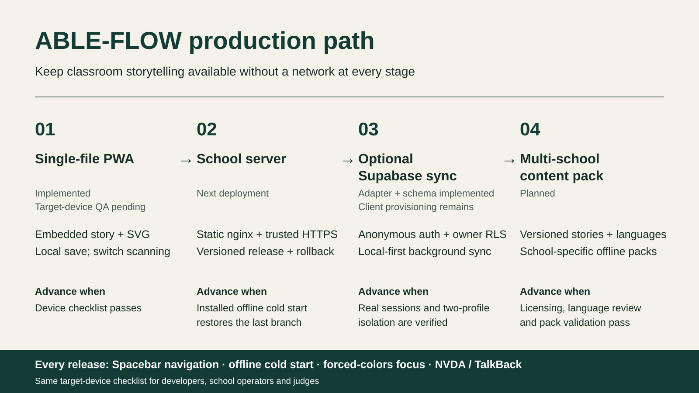

# ABLE-FLOW production path — one slide

| Stage | What is delivered | Evidence needed to advance |
| --- | --- | --- |
| 1. Single-file PWA | Embedded story and SVG symbols; switch scanning; local saves. Implemented, with target-device QA pending. | All four manual accessibility checks pass on the intended device. |
| 2. Static hosting on the school server | nginx + trusted HTTPS; a stable origin; complete, versioned releases and rollback. Next deployment step. | Installed offline cold start restores the last branch; update and rollback preserve progress. |
| 3. Optional Supabase sync | Anonymous Auth, owner-only RLS, local-first background upserts and newer-only startup merges. Adapter and schema implemented; opt-in client provisioning remains an integration task. | Real client/session provisioning and two-profile isolation verified; story still works without sync. |
| 4. Multi-school content pack | Versioned, school-specific story/language packs with offline distribution. Planned. | Content licensing, educator approval, reviewed AAC/SSL language, pack validation and compatibility tested. |

Release gate at every stage: Spacebar navigation → offline cold start → forced-
colors focus → NVDA/TalkBack announcements. Use [the same checklist](accessibility-checklist.md)
for developers, school operators and judges. These are staged readiness criteria,
not claims that production deployment or target-device verification is complete.
